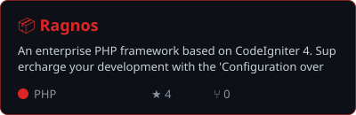
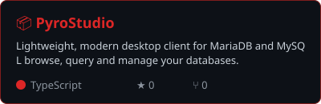

<!-- Banner -->
<p align="center">
  
</p>

<p align="center">
  
</p>

<p align="center">
  <a href="https://ragnos.build"></a>
  <a href="https://www.linkedin.com/in/cgarciagl"></a>
  <a href="https://x.com/cgarciagl"></a>
  <a href="https://leanpub.com/u/cgarciagl"></a>
</p>

---

```bash
$ whoami
carlos — ingeniero de software y técnico académico @ Universidad Veracruzana 🇲🇽
$ cat enfoque.txt
Sistemas de administración escolar · innovación en educación superior
$ ls ./creaciones
ragnos/   pyrostudio/   ragnos-de-cero-a-pro.pdf
$ open https://ragnos.build
$ echo $STACK
PHP  SQL  JavaScript  MariaDB/MySQL
```

### 🚀 Proyectos destacados

<p align="center">
  <a href="https://github.com/cgarciagl/Ragnos"></a>
  <a href="https://github.com/cgarciagl/PyroStudio"></a>
</p>

| | |
|---|---|
| **Ragnos** | Framework PHP para construir aplicaciones de negocio con mucho menos código. 🌐 [ragnos.build](https://ragnos.build) |
| **PyroStudio** | Cliente de escritorio para MariaDB/MySQL, ligero y directo. |

### 📦 Últimas versiones

<!-- RELEASES:START -->
| Proyecto | Versión | Fecha | |
|---|---|---|---|
| **Ragnos** | `v1.0.2` | 2026-11-04 | [Ver notas](https://github.com/cgarciagl/Ragnos/releases/tag/v1.0.2) |
| **Ragnos** | `v1.0.1` | 2026-11-04 | [Ver notas](https://github.com/cgarciagl/Ragnos/releases/tag/v1.0.1) |
| **PyroStudio** | _próximamente_ | — | [Repo](https://github.com/cgarciagl/PyroStudio) |
<!-- RELEASES:END -->

### 📚 Mi libro

> **Ragnos de Cero a Pro** — la guía completa del framework, del primer CRUD a producción.

<p>
  <a href="https://leanpub.com/ragnosdeceroapro"></a>
  <a href="https://leanpub.com/ragnosfromzerotopro"></a>
</p>

### 🛠 Stack

<p>
  
</p>

### 🌌 Hace mucho tiempo, en un repositorio muy, muy lejano...

<p align="center">
  
</p>

<p align="center">
  <picture>
    <source media="(prefers-color-scheme: dark)" srcset="https://raw.githubusercontent.com/cgarciagl/cgarciagl/output/snake-dark.svg" />
    
  </picture>
</p>

<details>
<summary>🇬🇧 <b>English</b></summary>

Software engineer at Universidad Veracruzana (Mexico), M.Sc. in Software Engineering.
I build **Ragnos**, a PHP framework for business apps, and **PyroStudio**, a MariaDB/MySQL desktop client.
Author of *Ragnos From Zero to Pro* on Leanpub. Website: [ragnos.build](https://ragnos.build)
</details>

<p align="center">
  
</p>
